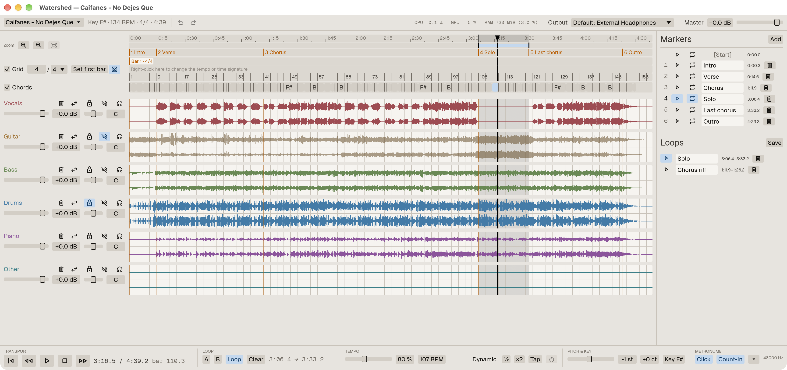
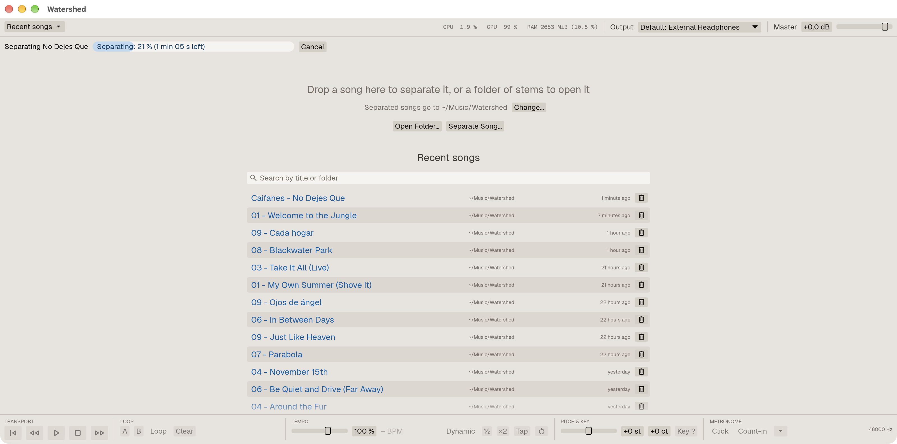

# Watershed

Separate a song into stems and practice over them.

## In short, for musicians

- **Drop a song, get the band apart.** Vocals, drums, bass, guitar, piano and the
  rest, each on its own track, in a minute or two. It all happens on your
  computer: nothing is uploaded.
- **Take your part out.** Mute the guitar and play it yourself over the band, or
  solo the bass to hear what it really plays.
- **Slow it down without changing the key,** or change the key without changing
  the speed.
- **Loop the hard part.** Mark it, loop it, save as many loops as you like, and
  name the song's sections (verse, chorus, solo) to jump between them.
- **Play in time.** A click and a count-in that follow the song, even when the
  band did not play to a click. The tempo and key are shown.
- **Picks up where you left off.** Your mix, loops and markers are saved with
  each song.
- **Free and open source.** Use it next to your DAW: your instrument goes through
  Reaper (or whatever you use), Watershed plays the band.

**What you need to split songs:** a **Mac with Apple Silicon** (M1 or newer), or
a **PC with an NVIDIA graphics card** (Windows or Linux; other recent graphics
cards work too, but are less tested and may be slower). On a PC without one, you
can still practice over stems you already have, for example from
[MVSEP](https://mvsep.com). Intel Macs are not supported.

## About

Watershed is an open-source desktop app for musicians who learn songs by ear.
Drop in an mp3, flac, wav, ogg or m4a file. Watershed splits it locally, on your
GPU, into vocals, drums, bass, guitar, piano and other with a state-of-the-art
RoFormer model, then opens the stems in a multitrack player built for practice.

It is meant to run next to your DAW. Your live instrument stays in Reaper (or
whatever you use); Watershed only plays the backing stems.

The name is a tribute to "Watershed" by Opeth.



## Download

Get the latest version from [Releases](../../releases/latest):

| System | File |
|---|---|
| Windows 10/11 (x86_64) | `Watershed-*-windows-x86_64.zip` |
| macOS 11+ (Apple Silicon) | `Watershed-*-macos-arm64.dmg` |
| Linux (x86_64, glibc 2.35+) | `Watershed-*-linux-x86_64.AppImage` |

**A GPU is required** to separate songs: Metal on macOS, Vulkan on Windows and
Linux (any recent NVIDIA, AMD or Intel driver). Playing stems works without one.
The separation model (700 MB) downloads on the first separation.

The builds are not signed yet, so the system warns before the first start:

- **Windows:** unzip and run `watershed.exe`. If SmartScreen says "Windows protected
  your PC", choose **More info → Run anyway**.
- **macOS:** open the `.dmg` and drag Watershed to Applications. The first time, macOS
  says it cannot check the app: open **System Settings → Privacy & Security** and
  choose **Open Anyway** next to Watershed.
- **Linux:** make the file executable (`chmod +x Watershed-*.AppImage`) and run it.
  AppImages need FUSE 2 (`libfuse2`, called `libfuse2t64` on Ubuntu 24.04).

Watershed is young: tested daily on macOS and Windows by its author, less so on
Linux. Please [open an issue](../../issues) if something does not work.

## Features

- **Separation:** drop a song and it is split into six stems in a new folder of
  your library (`Music/Watershed` by default), with a progress bar and Cancel. The
  model (BS-RoFormer SW) downloads on first use (700 MB, checked by sha256) and is
  stored in f16 (350 MB). It runs in Rust (`burn` + `wgpu`) on the GPU: Metal on
  macOS, Vulkan on Windows and Linux. A GPU is required. A 4 minute song takes
  about 1–2 minutes on a laptop or mid-range GPU. Stems are saved as Ogg Vorbis
  (~25 MB per song) or, in Settings, as 24-bit FLAC.
- **Player:** one row per stem with its waveform, volume, pan, mute and solo;
  master volume and output device. Folders of stems from other tools (for example
  [MVSEP](https://mvsep.com)) open too, and stems that start late can be dragged
  into place.
- **Practice:** tempo change without pitch change, transposition in semitones
  (drums are left untransposed by default), A-B loops with several saved per song,
  named markers and sections, waveform zoom.
- **Tempo and key:** an approximate BPM and key estimated when a song opens, with
  tap tempo and ½ / ×2 to correct the BPM; a beat grid with a bar ruler and snap;
  a click (left, right or both ears) and a count-in. **Dynamic** makes the grid and
  the click follow the song's own beats, for bands that were not playing to a
  click. Tempo and time signature changes can be marked, as in a DAW.
- **Sessions:** everything is saved next to the stems in `.watershed.toml`, so a
  song reopens as you left it and is never separated twice. Recently opened songs
  are listed on the start screen.



## Building from source

Requires Rust 1.95 or newer:

```sh
cargo run --release
```

Per platform:

- **macOS:** `xcode-select --install`.
- **Windows:** the Visual Studio Build Tools and LLVM (`winget install LLVM.LLVM`,
  with `LIBCLANG_PATH` set to its `bin` folder).
- **Linux** (Debian/Ubuntu names):

  ```sh
  sudo apt install libxkbcommon-dev libxcb-render0-dev libxcb-shape0-dev \
    libxcb-xfixes0-dev libwayland-dev libasound2-dev
  ```

  Also clang (`libclang-dev`), for the time-stretching library's bindings.

## Usage

Drop a song file on the window to separate it, or drop a folder of stems (or use
**Open folder…**, or pass it on the command line: `watershed path/to/stems`) to
play it. Stems are recognized by name, in English or Spanish (`vocals`/`voz`,
`drums`/`bateria`, `bass`/`bajo`, `guitar`/`guitarra`, `piano`/`teclado`, `other`,
`instrumental`).

Some shortcuts (press **?** in the app for the full list):

| Key | Action |
|---|---|
| Space | Play / pause |
| Home | Back to the loop start, or the song start |
| ← / → | Seek 5 s |
| A / B, L | Loop start / end at the playhead, loop on or off |
| M, 1–9 | Add a marker, go to marker 1–9 |
| T | Tap tempo |
| C | Click on or off |
| Shift+C | Change the tempo or time signature at the playhead |
| + / − | Zoom |
| F5 | Reload the song folder |
| Cmd/Ctrl+, | Settings |

Click or drag on any waveform to seek.

**With Reaper on Windows:** Watershed plays through shared-mode WASAPI, so it can
share an audio interface with Reaper on ASIO. Set both to the same sample rate.

## Workspace layout

| Crate | Purpose |
|---|---|
| `crates/app` | The `watershed` binary: egui user interface |
| `crates/audio` | Real-time playback engine: mixer, tempo and pitch, limiter, click |
| `crates/dsp` | Decoding, FLAC and Ogg Vorbis writing, resampling, waveforms, tempo and key estimation |
| `crates/roformer` | BS-RoFormer in Rust on `burn` + `wgpu`, validated against PyTorch |
| `crates/separation` | Model catalog, downloads and installation; a song to a folder of stems |
| `crates/storage` | Sessions, model cache and configuration |
| `tools/reference` | Development-only PyTorch reference separation ([README](tools/reference/README.md)) |

## Roadmap

Next: more RoFormer models (MelBand-RoFormer) and a model browser, and a gentler
separation mode that does not keep the GPU at full load. Details in
[the plan](docs/PLAN.md) and [the status](docs/STATUS.md).

## License

Licensed under either of

- Apache License, Version 2.0 ([LICENSE-APACHE](LICENSE-APACHE))
- MIT license ([LICENSE-MIT](LICENSE-MIT))

at your option.

Separation models are not part of this repository and are downloaded from their
original sources. Each model has its own license (some have none declared).

Unless you explicitly state otherwise, any contribution intentionally submitted
for inclusion in the work by you, as defined in the Apache-2.0 license, shall be
dual licensed as above, without any additional terms or conditions.
